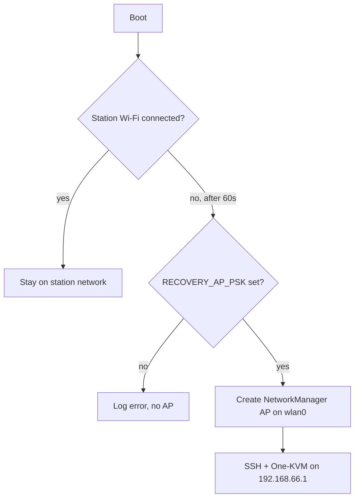

# Networking

The TaishanPi appliance joins a station Wi-Fi network as its primary link and
falls back to a local recovery hotspot when the station network is unreachable.
SSH and the One-KVM Web UI are exposed over whichever link is active.

## Components

| Component | Role |
|-----------|------|
| `NetworkManager` | Owns `wlan0` and all connections |
| `wpa_supplicant` | Backend selected by NetworkManager for WPA2 |
| `avahi-daemon` | mDNS name resolution (`taishankvm.local`) |
| `one-kvm-recovery-ap.service` / `.timer` | Optional recovery hotspot |
| `wifi-recovery-ap.sh` | Creates the hotspot with `nmcli` |

## Station mode (primary)

The station profile is generated at build time by
`scripts/rootfs/customize.sh` from the gitignored `config/local.env`:

```
WIFI_SSID="DIY-K3"
WIFI_PSK="<secret>"
WIFI_COUNTRY="CN"
```

The generated NetworkManager keyfile lives at
`/etc/NetworkManager/system-connections/<SSID>.nmconnection` with mode `0600`.
The PSK is never written to the build logs.

A build-time override is supported for private images: export `WIFI_SSID` and
`WIFI_PSK` before `make rootfs` and they take precedence over `config/local.env`.

### Provisioning rules

- Never commit real Wi-Fi credentials.
- `config/local.env.example` is the committed, empty template.
- `config/local.env` is gitignored and holds the real values.
- `make verify` fails if `config/local.env` is tracked or if a tracked file
  contains the literal PSK.

## Recovery AP (fallback)

When `ENABLE_RECOVERY_AP=1` (default), `one-kvm-recovery-ap.timer` fires
`OnBootSec=60s`. `wifi-recovery-ap.sh` then:

1. checks whether any Wi-Fi device is already connected;
2. if connected, exits without changing anything;
3. otherwise creates a NetworkManager AP connection on `wlan0`.

| Variable | Default | Meaning |
|----------|---------|---------|
| `RECOVERY_AP_SSID` | `taishankvm-recovery` | Hotspot SSID |
| `RECOVERY_AP_PSK` | (empty, required) | WPA2 password, >= 8 chars |
| `RECOVERY_AP_ADDRESS` | `192.168.66.1/24` | Hotspot gateway address |
| `RECOVERY_AP_TIMEOUT` | `60` | Grace period before fallback (seconds) |

The hotspot uses `ipv4.method shared`, so it provides DHCP to clients. SSH and
the One-KVM Web UI are reachable at the hotspot address. If `RECOVERY_AP_PSK`
is empty the script refuses to start an open network and logs an error.



## mDNS

`avahi-daemon` is enabled, advertising `TARGET_HOSTNAME` (default
`taishankvm`). The device is reachable as `taishankvm.local` on the local
segment. Set `TARGET_MDNS_NAME`/`TARGET_HOSTNAME` in `config/build.env` to
change it.

## SSH

- `openssh-server` is installed and `ssh.service` is enabled at boot.
- Root login is disabled (`PermitRootLogin no`).
- Public-key authentication is preferred; the key from `SSH_PUBLIC_KEY_FILE`
  is installed as `authorized_keys` for `TARGET_USERNAME`.
- Password authentication is disabled unless `ALLOW_PASSWORD_SSH=1`
  (development only). If no public key is supplied, `customize.sh` enables
  password auth as a fallback and logs a warning.

## Configuration reference

From `config/build.env.example`:

| Variable | Default | Meaning |
|----------|---------|---------|
| `TARGET_HOSTNAME` | `taishankvm` | System hostname |
| `TARGET_MDNS_NAME` | `taishankvm.local` | Advertised mDNS name |
| `WIFI_COUNTRY` | `CN` | Regulatory domain for `wireless-regdb` |
| `ENABLE_MDNS` | `1` | Enable Avahi |
| `ENABLE_RECOVERY_AP` | `1` | Enable the recovery hotspot fallback |
| `RECOVERY_AP_TIMEOUT` | `60` | Fallback delay in seconds |
| `ALLOW_PASSWORD_SSH` | `0` | Development password-auth toggle |
