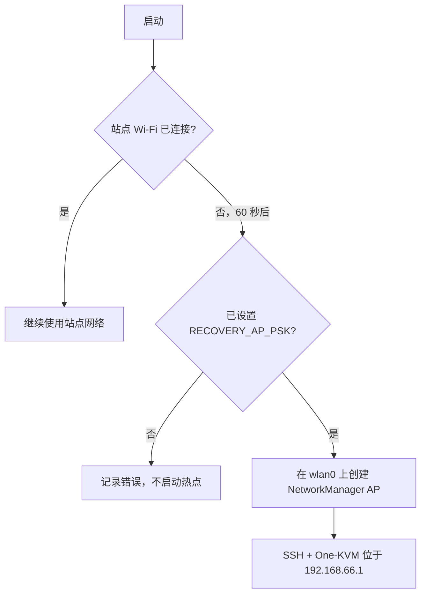

# 网络

泰山派设备以站点 Wi-Fi 作为主链路；站点网络不可达时回退到本地恢复热点。SSH 和 One-KVM Web UI 在任一活动链路上均可访问。

> 英文原版：[`../NETWORK.md`](../NETWORK.md)

## 组件

| 组件 | 角色 |
|-----------|------|
| `NetworkManager` | 管理 `wlan0` 和所有连接 |
| `wpa_supplicant` | NetworkManager 为 WPA2 选择的后端 |
| `avahi-daemon` | mDNS 名称解析（`taishankvm.local`） |
| `one-kvm-recovery-ap.service` / `.timer` | 可选恢复热点 |
| `wifi-recovery-ap.sh` | 用 `nmcli` 创建热点 |

## 站点模式（主）

站点配置由 `scripts/rootfs/customize.sh` 在构建时从 gitignored 的 `config/local.env` 生成：

```
WIFI_SSID="DIY-K3"
WIFI_PSK="<机密>"
WIFI_COUNTRY="CN"
```

生成的 NetworkManager keyfile 位于
`/etc/NetworkManager/system-connections/<SSID>.nmconnection`，权限 `0600`。
PSK 绝不写入构建日志。

支持私有镜像的构建期覆盖：在 `make rootfs` 前导出 `WIFI_SSID` 和
`WIFI_PSK`，它们优先于 `config/local.env`。

### 配置规则

- 绝不提交真实 Wi-Fi 凭据。
- `config/local.env.example` 是入库的空模板。
- `config/local.env` 已 gitignore，存放真实值。
- 若 `config/local.env` 被跟踪，或任何被跟踪文件含字面 PSK，`make verify` 会失败。

## 恢复热点（回退）

当 `ENABLE_RECOVERY_AP=1`（默认）时，`one-kvm-recovery-ap.timer` 以
`OnBootSec=60s` 触发。`wifi-recovery-ap.sh` 随后：

1. 检查是否已有 Wi-Fi 设备处于连接状态；
2. 已连接则直接退出，不做任何改动；
3. 否则在 `wlan0` 上创建 NetworkManager AP 连接。

| 变量 | 默认值 | 含义 |
|----------|---------|---------|
| `RECOVERY_AP_SSID` | `taishankvm-recovery` | 热点 SSID |
| `RECOVERY_AP_PSK` | （空，必填） | WPA2 密码，>= 8 字符 |
| `RECOVERY_AP_ADDRESS` | `192.168.66.1/24` | 热点网关地址 |
| `RECOVERY_AP_TIMEOUT` | `60` | 回退前的等待时间（秒） |

热点使用 `ipv4.method shared`，向客户端提供 DHCP。SSH 和 One-KVM Web UI 可通过热点地址访问。若 `RECOVERY_AP_PSK` 为空，脚本拒绝启动开放网络并记录错误。



## mDNS

`avahi-daemon` 已启用，发布 `TARGET_HOSTNAME`（默认 `taishankvm`）。设备在本地网段以 `taishankvm.local` 可达。在 `config/build.env` 中设置 `TARGET_MDNS_NAME`/`TARGET_HOSTNAME` 可修改。

## SSH

- 已安装 `openssh-server`，`ssh.service` 开机自启。
- 禁止 root 登录（`PermitRootLogin no`）。
- 优先公钥认证；`SSH_PUBLIC_KEY_FILE` 中的公钥会安装为 `TARGET_USERNAME` 的 `authorized_keys`。
- 除非 `ALLOW_PASSWORD_SSH=1`（仅开发），否则禁用密码认证。若未提供公钥，`customize.sh` 会回退启用密码认证并记录警告。

## 配置参考

来自 `config/build.env.example`：

| 变量 | 默认值 | 含义 |
|----------|---------|---------|
| `TARGET_HOSTNAME` | `taishankvm` | 系统主机名 |
| `TARGET_MDNS_NAME` | `taishankvm.local` | 发布的 mDNS 名称 |
| `WIFI_COUNTRY` | `CN` | `wireless-regdb` 的管制域 |
| `ENABLE_MDNS` | `1` | 启用 Avahi |
| `ENABLE_RECOVERY_AP` | `1` | 启用恢复热点回退 |
| `RECOVERY_AP_TIMEOUT` | `60` | 回退延迟（秒） |
| `ALLOW_PASSWORD_SSH` | `0` | 开发用密码认证开关 |
